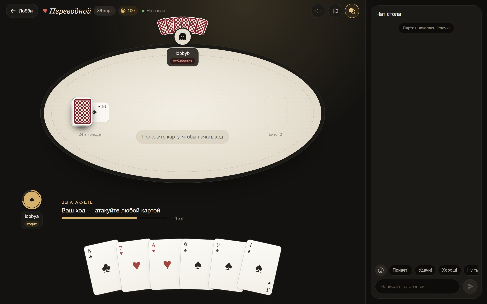
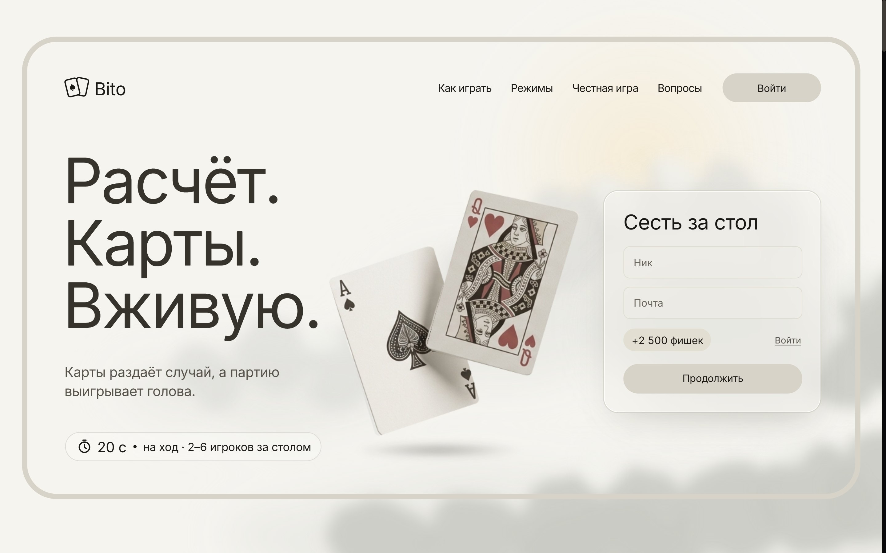
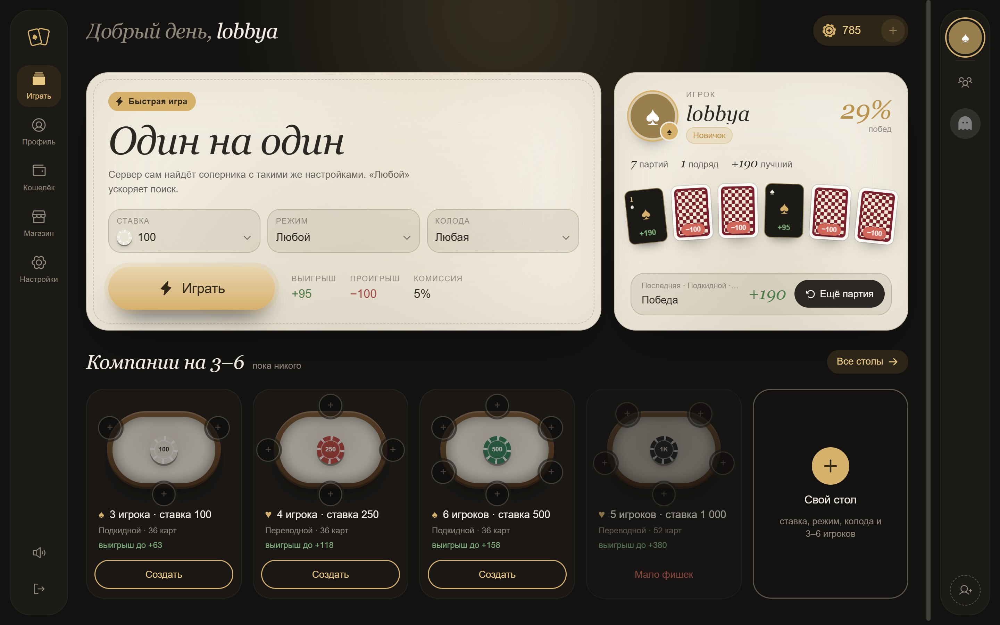
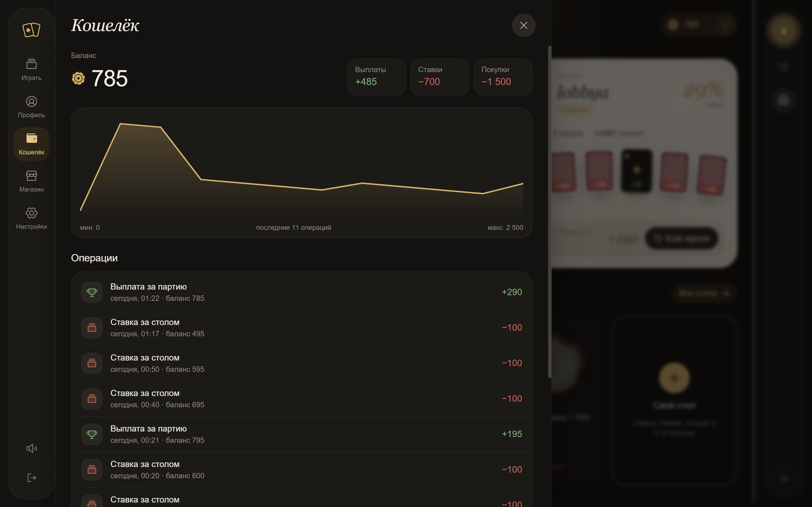
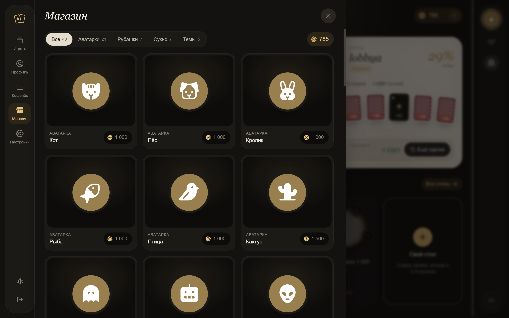
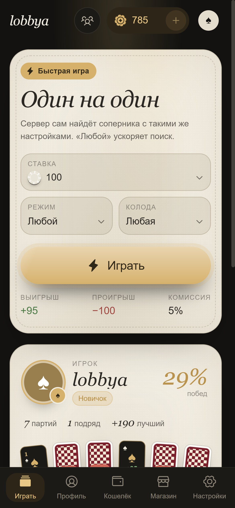
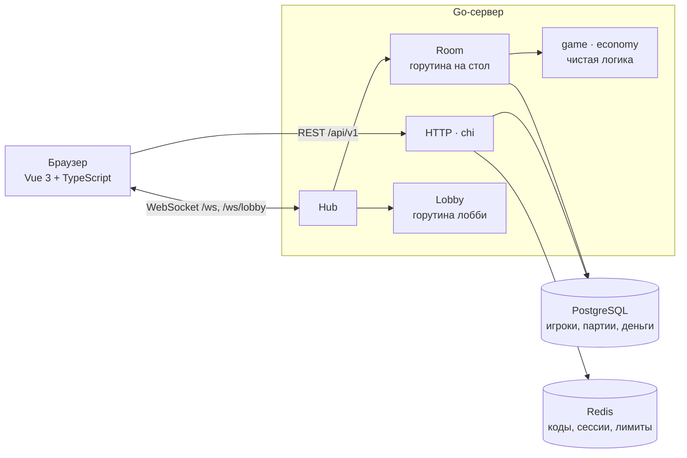

<div align="center">

# 🂡 Bito

**Онлайн-дурак в реальном времени на виртуальные фишки**

[](https://github.com/D4cLoves/Bito/actions/workflows/ci.yml)


Подкидной и переводной · колоды 24 / 36 / 52 · от 2 до 6 игроков · ставки, друзья, магазин

<br>



</div>

---

## Скриншоты

<table>
  <tr>
    <td width="50%"></td>
    <td width="50%"></td>
  </tr>
  <tr>
    <td align="center"><sub><b>Лендинг</b> · правила, режимы и вход</sub></td>
    <td align="center"><sub><b>Лобби</b> · быстрая игра, профиль, столы</sub></td>
  </tr>
  <tr>
    <td width="50%"></td>
    <td width="50%"></td>
  </tr>
  <tr>
    <td align="center"><sub><b>Кошелёк</b> · график баланса и журнал</sub></td>
    <td align="center"><sub><b>Магазин</b> · оформление за фишки</sub></td>
  </tr>
</table>

<p align="center">
  <br>
  <sub><b>На телефоне</b> · то же лобби с нижним меню</sub>
</p>

## Что умеет

**Игра**
- Подкидной и переводной дурак, колоды на 24, 36 и 52 карты, тасовка через `crypto/rand`
- Быстрая игра 1 на 1 с подбором соперника и столы-компании на 3–6 игроков
- Таймер хода 20 секунд: если игрок молчит, сервер ходит за него
- 30 секунд на возвращение при обрыве связи, кнопка «Вернуться за стол» после перезагрузки

**Вокруг стола**
- Ставки в виртуальных фишках: выплаты по местам, комиссия 5%, пополнение при нуле
- Кошелёк с графиком баланса и журналом всех операций
- Друзья со статусом «в лобби / за столом / не в сети», приглашение за свой стол
- Закрытые столы по приглашению или ссылке с ключом, реванш одной кнопкой
- Режим зрителя: смотреть идущую партию, не видя рук
- Живое лобби на WebSocket, чат за столом с быстрыми фразами и эмодзи
- История партий и профили игроков

**Оформление**
- Магазин за фишки: 7 тем, 9 сукон, 9 рубашек карт, 26 аватаров
- Звуки карт и музыка, сигнал «ваш ход» в свёрнутой вкладке
- Мобильная вёрстка, регистрация по коду из письма

## Как устроено



- **Один стол — одна горутина.** Сообщения игроков приходят в `Room` через канал, состоянием партии владеет только она, поэтому правилам не нужны блокировки.
- **Сервер главный.** Клиент шлёт только намерение (`attack`, `defend`, `take`, `pass`, `transfer`, `surrender`), допустимость проверяет сервер. Каждый игрок получает только свою руку.
- **Деньги в журнале.** Любое движение фишек — строка в `wallet_transactions` с `balance_after`. `CHECK (balance >= 0)`, атомарное списание ставки, расчёт партии ровно один раз.
- **Две базы.** PostgreSQL для того, что нельзя терять, Redis для того, что должно истечь само.

## Стек

| | |
|---|---|
| **Сервер** | Go 1.27, chi, gorilla/websocket, pgx v5, go-redis v9, golang-jwt v5, bcrypt, cleanenv |
| **Клиент** | Vue 3, TypeScript, Vite, Pinia, Vue Router, Tailwind CSS 4, anime.js, motion-v, Web Audio API |
| **Данные** | PostgreSQL 16 (11 таблиц, миграции встроены в бинарник), Redis 7 |
| **Инфраструктура** | Docker Compose, Mailpit, GitHub Actions |

## Запуск

Понадобятся Go 1.27, Node.js 22 и Docker.

```bash
cp .env.example .env
make up        # PostgreSQL, Redis и Mailpit в Docker
make run       # сервер на :8080, миграции применяются при старте
```

В соседнем терминале:

```bash
npm --prefix web ci
make web       # клиент на http://localhost:5173
```

Письма с кодом подтверждения смотрите в Mailpit: http://localhost:8025

## Тесты

```bash
make test         # все тесты на Go
make test-race    # то же с детектором гонок
npm --prefix web run build   # проверка типов и сборка клиента
```

CI на каждый push гоняет тесты с настоящими PostgreSQL и Redis, собирает клиент и Docker-образ.

## Структура

```
cmd/
  server/              точка входа
  cli/                 консольная партия для ручной проверки движка
internal/
  game/                правила дурака: колода, стол, ходы, без сети и БД
  economy/             расчёт выплат и каталог магазина
  delivery/http/       REST API, авторизация, лимиты
  delivery/ws/         Hub, комнаты, лобби, реванш, зрители
  service/             регистрация, профиль, кошелёк, друзья
  repository/          PostgreSQL и Redis
  pkg/                 JWT и почта
migrations/            SQL-миграции
web/                   клиент на Vue 3
docs/                  описание фич и планы реализации
```

## Документация

- [docs/features.md](docs/features.md) — все фичи, приоритеты и что сделано
- [docs/plans](docs/plans) — как устроены экономика, лобби, друзья, приглашения, зрители и CI
